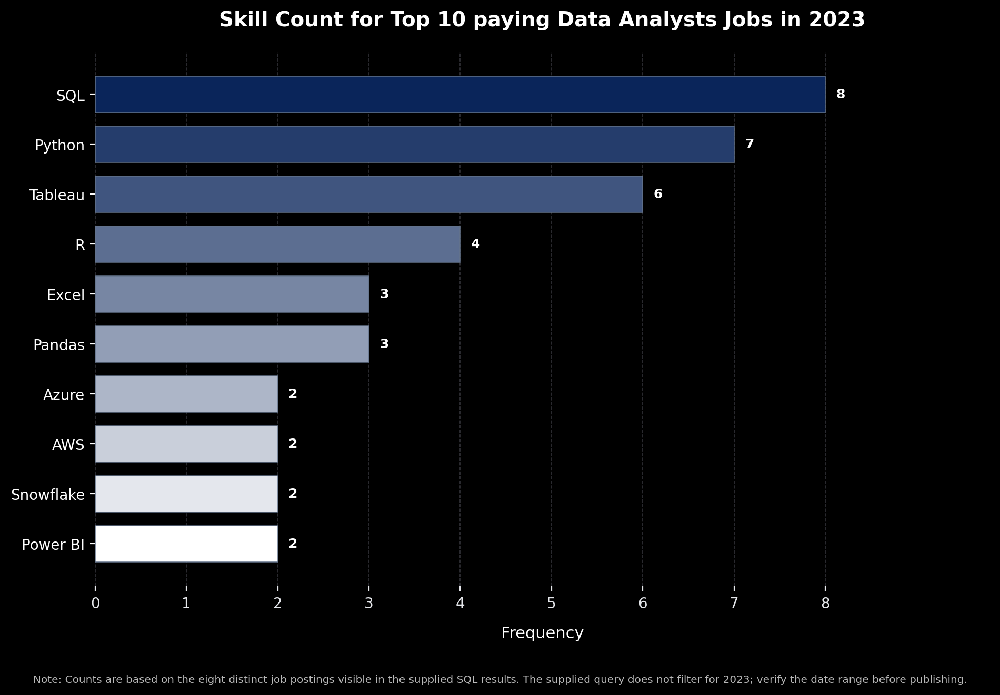

# 📊 Data Analyst Job Market Analysis

## 📌 Introduction

Dive into the data job market! This project explores data analyst roles, focusing on top-paying jobs, in-demand skills, and skills that combine high demand with competitive salaries.

🔍 SQL queries? Check them out here: [project_sql folder](/project_sql/)

## 🎯 Background

As someone learning data analytics living in Japan, I wanted to understand which technical skills employers value and which skills are associated with higher salaries. I went further ahead and only grabbed data for jobs that are either remote or in Japan.

This project uses SQL to answer four key questions:

- What are the highest-paying data analyst jobs?
- Which skills are most in demand?
- Which skills are associated with the highest salaries?
- Which skills offer a balance between demand and salary?

## 🛠️ Tools I Used


- **SQL** — Querying, filtering, joining, and analyzing job posting data.
- **PostgreSQL** — Storing and managing the database used for the analysis.
- **VS Code** — Writing and organizing SQL queries.
- **GitHub** — Sharing and documenting the project in my data analytics portfolio.

### SQL Skills

`JOIN` · `GROUP BY` · `COUNT()` · `AVG()` · `WHERE` · `ORDER BY` · CTEs

## 🔎 The Analysis

### 1. Top-Paying Data Analyst Jobs

Identified the 10 highest-paying data analyst job postings among remote or Japan-based opportunities with reported yearly salaries.
```sql
SELECT
    job_id,
    job_title,
    job_location,
    job_schedule_type,
    salary_year_avg,
    job_posted_date,
    name AS company_name
FROM
    job_postings_fact
LEFT JOIN company_dim ON job_postings_fact.company_id = company_dim.company_id
WHERE 
    job_title_short = 'Data Analyst' AND
    (job_work_from_home = True OR job_location ='Japan') AND
    salary_year_avg IS NOT NULL
ORDER BY 
    salary_year_avg DESC
LIMIT 10;
```


*Bar graph visualizing the salary for the top 10 salaries for data analysts; ChatGPT generated this graph from my SQL query results*

### 2. Skills Required for Top-Paying Jobs

Examined the technical skills associated with the highest-paying roles. SQL, Python, R, and data visualization tools appeared among the skills listed in the results.
```sql
WITH top_paying_jobs AS (
    SELECT
        job_id,
        job_title,
        salary_year_avg,
        name AS company_name
    FROM
        job_postings_fact
    LEFT JOIN company_dim ON job_postings_fact.company_id = company_dim.company_id
    WHERE 
        job_title_short = 'Data Analyst' AND
        (job_work_from_home = True OR job_location ='Japan') AND
        salary_year_avg IS NOT NULL
    ORDER BY 
        salary_year_avg DESC
    LIMIT 10
)


SELECT 
    top_paying_jobs.*,
    skills
FROM top_paying_jobs
INNER JOIN skills_job_dim ON top_paying_jobs.job_id = skills_job_dim.job_id
INNER JOIN skills_dim ON skills_job_dim.skill_id = skills_dim.skill_id
ORDER BY
    salary_year_avg DESC
```

*Bar graph visualizing the top skills for Data Analyst; ChatGPT generated this graph from my SQL query results*

### 3. Most In-Demand Skills

Ranked skills by their frequency in data analyst job postings to identify which skills employers request most often.
```sql
SELECT 
    skills,
    COUNT(skills_job_dim.job_id) AS demand_count
FROM job_postings_fact
INNER JOIN skills_job_dim ON job_postings_fact.job_id = skills_job_dim.job_id
INNER JOIN skills_dim ON skills_job_dim.skill_id = skills_dim.skill_id
WHERE
    job_title_short = 'Data Analyst' AND
    (job_work_from_home = True OR job_location ='Japan')
GROUP BY 
    skills
ORDER BY 
    demand_count DESC
LIMIT 5;
```
| Skills | Demand Count |
| :--- | :--- |
| SQL | 7346 |
| Excel | 4638 |
| Python | 4375 |
| Tableau | 3772 |
| Power BI | 2623 |
*Table of the demand for the top 5 skills in data analyst job postings*


### 4. Highest-Paying Skills
Calculated average yearly salaries by skill. PySpark ranked first in the results at approximately **$208,172**, followed by Bitbucket at approximately **$189,155**.
```sql
SELECT 
    skills,
    ROUND(AVG(salary_year_avg), 0) AS avg_salary
FROM job_postings_fact
INNER JOIN skills_job_dim ON job_postings_fact.job_id = skills_job_dim.job_id
INNER JOIN skills_dim ON skills_job_dim.skill_id = skills_dim.skill_id
WHERE
    job_title_short = 'Data Analyst' AND
    salary_year_avg IS NOT NULL AND
    (job_work_from_home = True OR job_location ='Japan')
GROUP BY 
    skills
ORDER BY 
    avg_salary DESC
LIMIT 25;
```

| Skills | Avg Salary |
| :--- | :--- |
| pyspark | $208,172 |
| bitbucket | $189,155 |
| couchbase | $160,515 |
| watson | $160,515 |
| datarobot | $155,486 |
| gitlab | $154,500 |
| swift | $153,750 |
| jupyter | $152,777 |
| pandas | $151,821 |
| elasticsearch | $145,000 |

*Table of the top 10 highest-paying skills based on average salary*

### 5. Optimal Skills

Combined skill demand and average salary to identify skills that appeared in more than 10 job postings and were associated with competitive salaries.

```sql
WITH skills_demand AS (

    SELECT 
        skills_dim.skill_id,
        skills_dim.skills,
        COUNT(skills_job_dim.job_id) AS demand_count
    FROM job_postings_fact
    INNER JOIN skills_job_dim 
        ON job_postings_fact.job_id = skills_job_dim.job_id
    INNER JOIN skills_dim 
        ON skills_job_dim.skill_id = skills_dim.skill_id
    WHERE
        job_title_short = 'Data Analyst' AND
        salary_year_avg IS NOT NULL AND
        (job_work_from_home = True OR job_location = 'Japan')
    GROUP BY 
        skills_dim.skill_id,
        skills_dim.skills
), average_salary AS (

    SELECT 
        skills_job_dim.skill_id,
        ROUND(AVG(salary_year_avg), 0) AS avg_salary
    FROM job_postings_fact
    INNER JOIN skills_job_dim 
        ON job_postings_fact.job_id = skills_job_dim.job_id
    INNER JOIN skills_dim 
        ON skills_job_dim.skill_id = skills_dim.skill_id
    WHERE
        job_title_short = 'Data Analyst' AND
        salary_year_avg IS NOT NULL AND
        (job_work_from_home = True OR job_location = 'Japan')
    GROUP BY 
        skills_job_dim.skill_id
)

SELECT
    skills_demand.skill_id,
    skills_demand.skills,
    demand_count,
    avg_salary
FROM skills_demand
INNER JOIN average_salary 
    ON skills_demand.skill_id = average_salary.skill_id
WHERE 
    demand_count > 10
ORDER BY 
    avg_salary DESC,
    demand_count DESC
LIMIT 25;
```
| Skills | Demand Count | Avg Salary |
| :--- | :--- | :--- |
| go | 27 | $115,320 |
| confluence | 11 | $114,210 |
| snowflake | 37 | $112,948 |
| hadoop | 23 | $111,715 |
| azure | 34 | $111,225 |
| bigquery | 13 | $109,654 |
| aws | 33 | $107,435 |
| java | 17 | $106,906 |
| ssis | 12 | $106,683 |
| jira | 20 | $104,918 |

*Table of the top 10 skills by average salary*

## 📚 What I Learned

- How to combine multiple tables using `JOIN`.
- How to aggregate data using `COUNT()` and `AVG()`.
- How to organize complex queries using Common Table Expressions (CTEs).
- How to filter and rank results to answer specific business questions.
- How to turn raw job posting data into useful career insights.

## 💡 Conclusions

- SQL, Python, and data visualization are useful skills to investigate when preparing for data analyst roles.
- Specialized technical skills can be associated with higher average salaries.
- Evaluating both salary and demand provides a more balanced view of the job market.
- This project strengthened my SQL skills and helped me understand how data analysis can support career decisions.

*Note: Findings reflect the job postings and filters used in this project. Salary figures are averages from the selected data, not guaranteed earnings.*